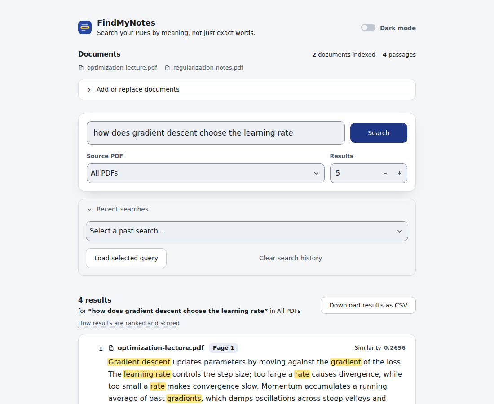
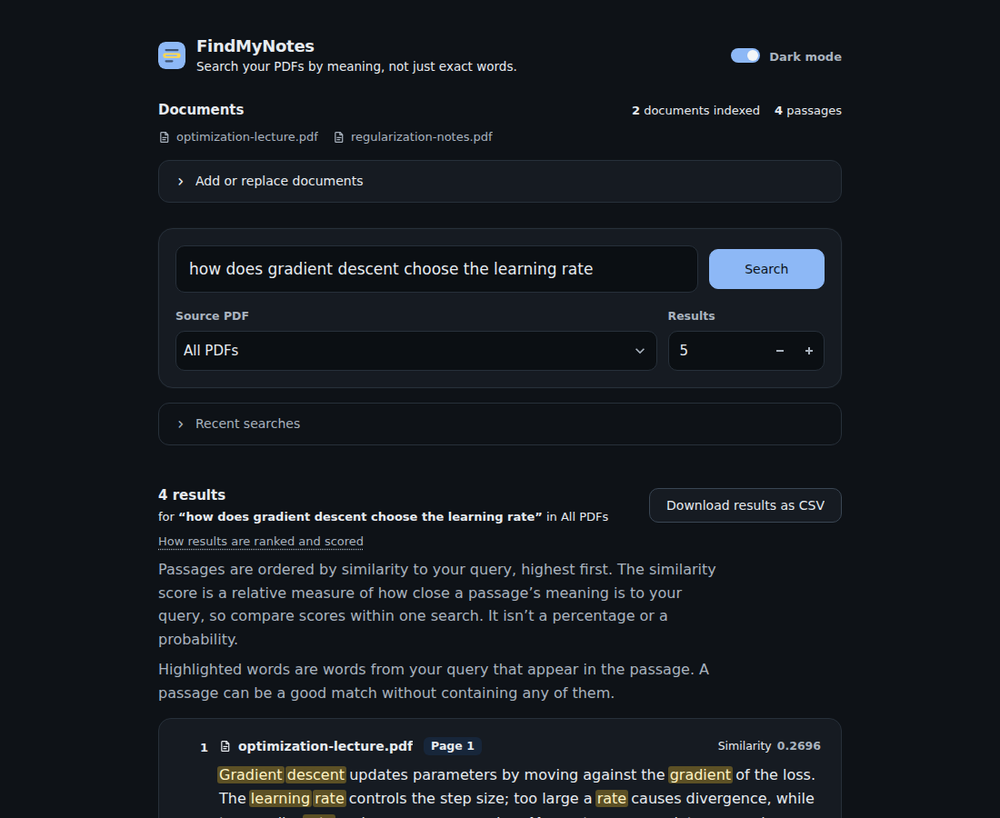

# FindMyNotes

**Find anything in your PDFs by meaning, not just keywords.**

FindMyNotes is a semantic document search tool that helps you rediscover information buried in lecture notes, technical documentation, research papers, and other PDFs. Search naturally, find relevant passages across multiple documents, and jump straight to the page containing the information.

**[Live Demo](https://findmynotes.streamlit.app/) · [Source Code](https://github.com/raindr0-0p/FindMyNotes)**

---

## See it in action



<details>
<summary>View dark theme</summary>



</details>

## Why FindMyNotes?

Traditional document search works best when you remember the exact words used in a document. But often, you remember the concept rather than the wording.

FindMyNotes uses semantic similarity to retrieve passages that are conceptually related to your query, even when the wording differs.

Search for an idea. Discover the passages that discuss it. Find the original source.

## Features

- **Semantic search** — Find conceptually relevant passages using natural-language queries.
- **Multi-PDF indexing** — Search across multiple PDF documents in one workspace.
- **Source-aware results** — Every result includes its source filename and page number.
- **Relevance ranking** — Results are ranked by cosine similarity between query and passage embeddings.
- **Flexible result count** — Choose how many results to retrieve, from 1 to 100.
- **Source filtering** — Narrow results to a specific PDF without rebuilding the index.
- **CSV export** — Download search results for reference, analysis, or record keeping.
- **Recent search history** — Revisit previous queries and rerun searches.
- **Light and dark themes** — Choose the appearance that suits your workspace.
- **Privacy-conscious local use** — Run the application on your own machine, with document processing and search performed locally after the required model is available.

## How it works

FindMyNotes combines pretrained text embeddings with vector similarity search.

```text
PDF documents
     |
     v
Extract text page by page
     |
     v
Split text into overlapping chunks
     |
     v
Generate passage embeddings
     |
     v
User enters a search query
     |
     v
Embed the query
     |
     v
Calculate cosine similarities
     |
     v
Rank passages and display source pages
```

### Search pipeline

1. **Text extraction:** PyMuPDF extracts text from PDF pages while preserving page references.
2. **Chunking:** Extracted text is divided into overlapping chunks so that passages retain useful context.
3. **Embedding generation:** The `sentence-transformers/all-MiniLM-L6-v2` model converts each chunk into a numerical vector representing its semantic content.
4. **Similarity search:** The query is embedded using the same model. NumPy calculates cosine similarity between the query vector and indexed passage vectors.
5. **Retrieval:** The most similar passages are returned with their filenames, page numbers, and similarity scores.

The document embeddings are computed during indexing and reused for subsequent searches. Filtering by source PDF narrows the candidate passages without re-embedding the documents.

Similarity scores indicate vector similarity; they are not probabilities or guarantees of correctness.

## Technology

| Component | Technology |
|---|---|
| Application interface | Streamlit |
| Language | Python |
| PDF text extraction | PyMuPDF |
| Text embeddings | Sentence Transformers |
| Embedding model | `all-MiniLM-L6-v2` |
| Vector operations and similarity | NumPy |
| Automated testing | pytest |

## Run locally

### Prerequisites

- Python installed on your machine
- Git
- Internet access for the initial dependency and model downloads, if they are not already available

### 1. Clone the repository

```bash
git clone https://github.com/raindr0-0p/FindMyNotes.git
cd FindMyNotes
```

### 2. Create a virtual environment

**Windows — Command Prompt**

```bat
python -m venv .venv
.venv\Scripts\activate
```

**macOS / Linux**

```bash
python3 -m venv .venv
source .venv/bin/activate
```

### 3. Install dependencies

```bash
python -m pip install -r requirements.txt
```

### 4. Launch FindMyNotes

```bash
python -m streamlit run app.py
```

Streamlit will provide a local URL in the terminal, typically `http://localhost:8501`.

The embedding model may download the first time it is loaded. Subsequent runs can reuse the cached model.

### 5. Start searching

1. Upload one or more text-based PDFs.
2. Select **Index documents** and wait for indexing to finish.
3. Enter a natural-language query.
4. Review the ranked passages and their source pages.
5. Optionally filter by PDF, change the result count, or export the results as CSV.

## Run the tests

With the virtual environment activated:

```bash
python -m pytest -q
```

To run the real-model integration test, if included in your checkout:

**Windows — Command Prompt**

```bat
set RUN_REAL_MODEL_INTEGRATION=1
python -m pytest -q
```

The integration test may take longer because it loads the actual embedding model. Clear the environment variable afterward if you want to return to the default test configuration.

## Design principles

FindMyNotes is built around a few straightforward principles:

- **Search should be intuitive.** Users should be able to describe what they remember without knowing the exact wording.
- **Results should be traceable.** Retrieved passages always retain their document and page references.
- **The search pipeline should be understandable.** Embeddings and cosine similarity provide a clear, inspectable retrieval mechanism.
- **The interface should stay focused.** Document management, search, results, and history should support the task rather than compete for attention.

## Scope and limitations

FindMyNotes is designed for semantic retrieval from text-based PDFs.

- **Scanned documents:** OCR is not currently included. Image-only pages without extractable text cannot be indexed.
- **Generated answers:** FindMyNotes retrieves passages; it does not generate answers with an LLM.
- **Search accuracy:** Results depend on the quality of extracted text, chunking, and embedding similarity. Relevant passages are not guaranteed to appear in the top results.
- **Persistence:** The index and recent search history are maintained in Streamlit session state. They are not a permanent document database.
- **Local versus hosted use:** When run locally, the application processes documents on your machine after the required model is available. When using the hosted demo, uploaded files are processed by the hosting environment. Do not upload sensitive documents to the public demo.

---

**FindMyNotes — your documents, searchable by meaning.**