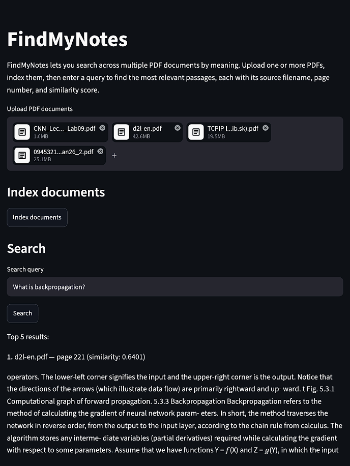

# FindMyNotes

FindMyNotes is a small, local-first semantic search application for PDF documents. Upload one or more PDFs, index their contents, and search by meaning to find the five most relevant passages, each with its source filename, page number, and similarity score.

## The problem it solves

When you have several PDFs, you may remember roughly what they say but not where a particular idea appears. Keyword search can miss relevant passages when your query uses different wording from the author.

FindMyNotes compares the meaning of a query with the meaning of passages in your documents. For example, asking *“Why does a Transformer need positional encoding to represent the order of tokens?”* can retrieve relevant passages even when the document phrases the idea differently.

## Features

- Upload multiple PDF documents through a Streamlit web interface.
- Extract text page by page while preserving 1-based page numbers.
- Split page text into overlapping word chunks, keeping the source filename and page number with each chunk.
- Generate text embeddings with `sentence-transformers/all-MiniLM-L6-v2`.
- Rank chunks by cosine similarity using NumPy.
- Display the top five matching passages with filename, page number, passage text, and similarity score.
- Handle invalid PDFs, PDFs without extractable text, empty queries, and searches without indexed documents.
- Include pytest unit tests and an opt-in real-model integration test.

## Technology stack

| Technology | Role |
|---|---|
| Python | Application language |
| PyMuPDF (`pymupdf`) | Page-by-page PDF text extraction |
| Sentence Transformers | Generates text embeddings with `all-MiniLM-L6-v2` |
| NumPy | Cosine similarity calculations and ranking |
| Streamlit | Web user interface |
| pytest | Automated tests |

## How it works

1. **PDF extraction:** `pdf_processor.extract_pages()` reads each uploaded PDF page by page and keeps the 1-based page number with the extracted text. Pages without extractable text are skipped; invalid or unreadable PDFs are rejected.
2. **Overlapping chunks:** `pdf_processor.chunk_pages()` splits each page's text into overlapping word chunks without combining different pages. Each chunk retains its source filename and page number.
3. **Embeddings:** `search_engine.build_index()` encodes the chunk texts and stores the NumPy embedding matrix alongside the chunk metadata.
4. **Similarity search:** `search_engine.search_chunks()` embeds the query, calculates cosine similarity against the indexed chunks, and ranks results from highest to lowest similarity.
5. **Source-aware results:** The app displays up to five ranked passages with their source filename, page number, text, and similarity score.

Similarity scores are **not probabilities**. Always check a retrieved passage in its original context.

## Project structure

```text
FindMyNotes/
├── app.py                    # Streamlit user interface
├── pdf_processor.py          # PDF extraction and page-aware text chunking
├── search_engine.py           # Embeddings, cosine similarity, and retrieval
├── requirements.txt           # Python dependencies
├── CLAUDE.md                  # Project instructions and frozen MVP scope
├── .gitignore                 # Git ignore rules
├── tests/
│   ├── test_pdf_processor.py  # PDF extraction and chunking tests
│   ├── test_search_engine.py  # Semantic search unit tests
│   └── test_real_pipeline.py  # Opt-in real-model integration test
└── README.md
```

## Setup on Windows

The commands below use **Windows Command Prompt (CMD)** unless a PowerShell section is explicitly shown.

### 1. Install Python

Install Python 3.10 or newer from [python.org](https://www.python.org/). The project has been tested with Python 3.13.3.

### 2. Open the project folder

Clone or download this repository, then open a terminal in the project folder. For example:

```bat
cd /d D:\findmynotes
```

### 3. Create and activate a virtual environment

```bat
py -m venv .venv
.venv\Scripts\activate.bat
```

In **PowerShell**, use this activation command instead:

```powershell
.\.venv\Scripts\Activate.ps1
```

### 4. Install dependencies

With the virtual environment activated, run:

```bat
python -m pip install --upgrade pip
python -m pip install -r requirements.txt
```

## Download the embedding model once

The app loads `sentence-transformers/all-MiniLM-L6-v2` with local-only loading. On a fresh setup, download and cache the model before launching the app. This step requires an internet connection:

```bat
python -c "from sentence_transformers import SentenceTransformer; SentenceTransformer('sentence-transformers/all-MiniLM-L6-v2')"
```

After the model has been downloaded and cached, the application can load it locally. If the model is not cached, the app will show an error rather than downloading it automatically.

## Run the app

With the virtual environment activated:

```bat
python -m streamlit run app.py --server.fileWatcherType=none
```

Then open [http://localhost:8502](http://localhost:8502) in your browser if it does not open automatically. Disabling the file watcher avoids noisy module-inspection warnings that can occur in some Windows environments; restart the app manually after code changes.

### Search your documents

1. Upload one or more PDFs using the file uploader.
2. Click **Index documents**. The app extracts text, creates chunks, and builds the search index.
3. Enter a natural-language query and click **Search**.
4. Review the top five passages, their source filenames, page numbers, and similarity scores.

If the selected PDFs change after indexing, index them again before searching so the results match the current selection.

## Run the tests

### Unit tests

These tests use deterministic fake embeddings where applicable; they do not load the real Sentence Transformers model:

```bat
python -m pytest tests/test_search_engine.py tests/test_pdf_processor.py -v
```

### Real-model integration test

The integration test is opt-in and requires the embedding model to be cached locally. In **CMD**:

```bat
set RUN_REAL_MODEL_INTEGRATION=1
python -m pytest tests/test_real_pipeline.py -v
set RUN_REAL_MODEL_INTEGRATION=
```

In **PowerShell**:

```powershell
$env:RUN_REAL_MODEL_INTEGRATION = "1"
python -m pytest tests/test_real_pipeline.py -v
Remove-Item Env:RUN_REAL_MODEL_INTEGRATION -ErrorAction SilentlyContinue
```

## Architecture

The application is intentionally simple and in-memory; it uses no database or external vector store.

- `pdf_processor.py` extracts PDF text and creates page-aware chunks.
- `search_engine.py` creates embeddings and retrieves chunks by cosine similarity.
- `app.py` provides the Streamlit interface and stores the current index in `st.session_state` so searching does not reprocess the PDFs.
- `tests/` contains unit tests and an opt-in real-model integration test.

## Limitations

- Only PDF documents are supported.
- Scanned or image-only PDFs are not supported because OCR is not implemented.
- Pages without extractable text are skipped; a PDF with no usable text cannot be indexed.
- No LLM-generated answers or chatbot are included. FindMyNotes retrieves passages rather than composing answers.
- Similarity scores are not probabilities or guaranteed measures of correctness. Check the original passages.
- There is no authentication, multi-user support, cloud deployment, or persistent index. Restarting the app clears the in-memory index.
- The embedding model must be downloaded and cached before the app can start in local-only mode.

## Screenshots


